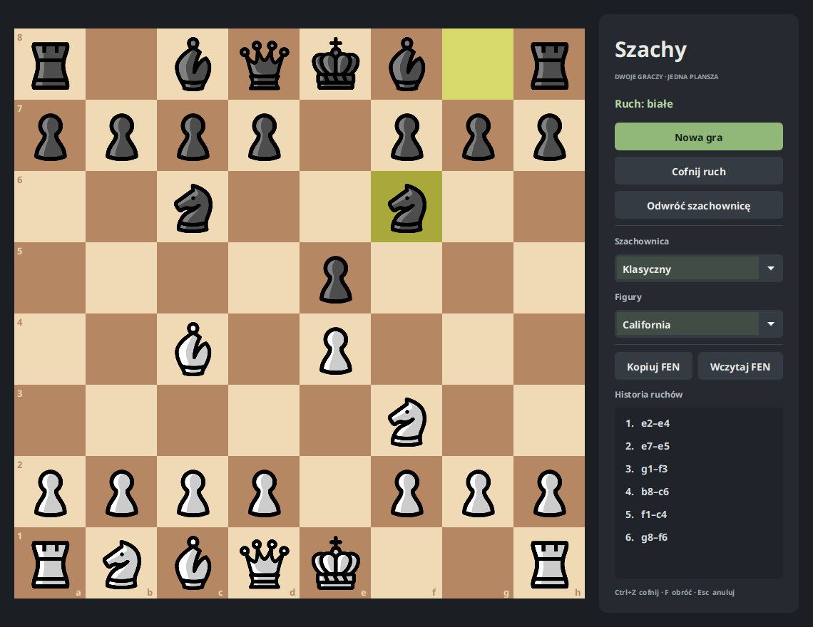

# Chess — JavaFX & MVVM

A local chess game for two players, built in Java 21 and JavaFX. The rules engine is independent of JavaFX; the interface uses MVVM, observable properties and a resizable Canvas board. UI language: Polish.



## Run

Install **JDK 21** and set `JAVA_HOME` if needed. Maven Wrapper downloads Maven and dependencies on the first run; no separate JavaFX SDK is needed.

```bash
# Linux / macOS — from the project directory
chmod +x mvnw
./mvnw javafx:run
```

Windows: `mvnw.cmd javafx:run`. Linux needs a graphical desktop and GTK 3 (Ubuntu: `sudo apt install libgtk-3-0`).

## Play

- Click a piece and its destination, or drag and drop. Legal moves, captures, check and the last move are highlighted.
- Castling, en passant and promotion to queen, rook, bishop or knight are supported. Undo restores the complete position, including castling rights, en passant and draw counters.
- Use **Ctrl+Z** to undo, **F** to flip the board, **Esc** to cancel selection/promotion and **Ctrl+N** for a new game. Undo during promotion cancels the pending choice.
- Choose from four board palettes and three piece sets. SVG pieces are cached at display-appropriate resolution.
- Copy or load a standard FEN position. Loading starts a new history; FEN cannot preserve earlier repetitions. The move list uses source–destination notation, not SAN/PGN.

This is a casual, untimed game: threefold repetition and the 50-move rule end the game automatically, without a claim dialog. Checkmate, stalemate and common insufficient-material positions are detected; arbitrary blocked dead positions are not analyzed. No AI, online play, Chess960 or saved sessions.

## Architecture

| Package | Responsibility |
| --- | --- |
| `model` | Position, legal moves, check detection, reversible move history, FEN and results; no JavaFX dependencies. |
| `viewmodel` | Commands, selection/promotion state and read-only observable properties. |
| `view` | Canvas rendering, coordinate mapping, themes and JavaFX controls; no chess-rule decisions. |

The existing `Board`, `MoveGenerator`, `CheckValidator`, move classes and MVVM structure were retained and corrected. Moves are validated before mutation; speculative moves are applied and undone for king-safety checks. Repetition keys include the side to move, castling rights and only a legally usable en passant target.

## Tests

```bash
./mvnw clean verify                       # rules, view model, coordinate mapping
./mvnw -Dchess.ui=true verify             # also test a real JavaFX window
# Headless Linux (requires xvfb):
xvfb-run -a ./mvnw -Dchess.ui=true verify
```

JUnit covers special moves, undo, draw bookkeeping, invalid commands, FEN and promotion state. Six standard perft positions check **500,117 leaf positions**. The optional JavaFX Robot test exercises clicks, dragging, flipping, resizing, all piece themes, promotion, checkmate and new-game controls. GitHub Actions runs both suites on Linux; UI tests write screenshots to `target/`.

## Licenses

Application code: [MIT](LICENSE). Bundled artwork has separate licenses and credits in [NOTICE.md](NOTICE.md), including a **noncommercial restriction on the California set**. Dependency and wrapper licenses remain their own.
